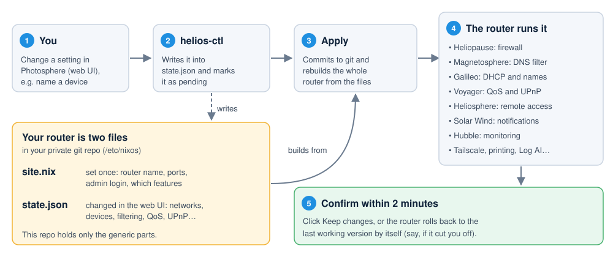

<p align="center"></p>

# HeliOS

**A home router operating system built on NixOS.** HeliOS turns a small x86 box and a
VLAN-capable switch into a router that splits your home into separate networks, filters
DNS per device, lets you in from anywhere over Tailscale, sends you push alerts, and
is managed from a web page, without giving up the things NixOS is good at: the whole
router is described in two files, every change can be rolled back, and nothing on it is
hidden from you.

> **AI-written notice.** Much of HeliOS's code and documentation was written with an
> AI assistant (Anthropic's Claude), directed and reviewed by the maintainer. It is
> tested (see [Tests](#tests)), but it is young software for a security-sensitive job.
> Read what you deploy, keep a way back (rollback, the rescue port), and please report
> anything wrong. See [SECURITY.md](SECURITY.md).

[Try the web UI demo](https://helios-router.github.io/helios/) (made-up data) ·
[Wiki](https://github.com/helios-router/helios/wiki) (every page and option explained)

## Why

Consumer routers put every device on one flat network, hide their settings and stop
getting updates. Router distributions like OpenWrt and OPNsense fix much of that, but
their configuration lives in a database you click through, which is hard to review,
version or reproduce. HeliOS takes the NixOS approach:

- **Declarative.** Your router is `site.nix` (the fixed parts: names, interfaces,
  which features you use) plus `state.json` (the parts you change often: devices,
  networks, QoS). Rebuild from them and you get the same router, every time.
- **Reversible.** Each change is a git commit and a NixOS generation. Changes from the
  web UI roll themselves back after two minutes unless you confirm them, so a mistake
  can't lock you out.
- **Segmented by default.** Your own devices, family devices, IoT gadgets, guests and
  switch admin pages live on separate VLANs, and the firewall is generated from what
  each network is allowed to do.
- **Readable.** It is a set of plain NixOS modules and one Python backend. No agents,
  no cloud account required, no telemetry.

## What it does

| Part | Job |
|---|---|
| **Heliopause** | nftables firewall generated from each network's access flags: isolation between networks, anti-spoofing, a trap for devices that probe the router, quarantine for devices you haven't named |
| **Magnetosphere** | DNS filtering with AdGuard Home on every network: forced DNS, DoT/DoH/WARP bypass blocking, per-device filter profiles |
| **Heliosphere** | optional remote access in an isolated container: a second, DNS-filtered Tailscale exit node, WireGuard and OpenVPN, each limited to the networks you choose |
| **Solar Wind** | self-hosted push notifications (ntfy), shown as *Notifications* in the UI: urgent alerts (flare) and informational ones (aurora) |
| **Photosphere** | the web UI, a Cockpit plugin: devices, networks, traffic, filtering, remote access, QoS, UPnP, printing, history and more |
| **Galileo** | addresses and names: DHCP on every network, fixed addresses and `<name>.home.arpa` names for the devices you name |
| **Voyager** | the WAN edge: CAKE or fq_codel QoS, and UPnP / NAT-PMP only where a network allows it |
| **Hubble** | monitoring: hardware watchdog and traffic statistics (an internet-outage monitor runs alongside Photosphere) |
| **Discovery** | optional AI log triage: a small local language model reads warnings and notifies you about the worrying ones |

Also: NTP for every network,
Tailscale admin access and exit node (or your own Headscale server), automatic
service recovery with alerts, a maintenance reboot window, a CUPS print server,
hardware drivers detected and enabled on request (UPS, LLDP), and a weekly
vulnerability scan.

## How it works



1. **Networks have roles; roles have access flags.** A network (one VLAN, one /24)
   gets a role such as *trusted*, *family*, *iot*, *guest*, *strict* or *mgmt*. The
   role sets flags like `internet`, `reach`, `filtered`, `admin`, `upnp`, `cast`, and
   you can override single flags per network. The firewall, DNS redirection, mDNS
   reflection and Tailscale routes are all generated from those flags.
2. **Devices are named in the UI.** Naming a device gives it a fixed address, a DNS
   name, a filter profile and options such as "media server". Unnamed devices can be
   limited to filtered internet until you name them.
3. **Changes are staged, applied, then confirmed.** Photosphere calls `helios-ctl`,
   which edits `state.json` and shows the change as pending. *Apply* commits it to
   git and runs `nixos-rebuild switch`; if you don't click *Keep changes* within two
   minutes, the router rolls back by itself. Pausing a device is instant.
4. **Nothing household-specific lives in this repository.** Names, addresses, MACs,
   users and keys come only from your `site.nix` and `state.json`, which you keep in
   your own private repository.

The router is "router-on-a-stick": one NIC carries every network as tagged VLANs to
a managed switch, and the modem sits in its own VLAN. An optional second NIC becomes
an out-of-band rescue port.

## Getting started

**You need:** a small x86-64 box, a managed switch with VLANs (and VLAN-aware access
points if you use Wi-Fi), and NixOS 25.11 or newer. Tailscale or a Headscale server is
optional.

**Installer:** build the ISO with `nix build .#installer-iso` (or download it from a
CI run on `main`), boot it, plug in a cable with internet and run `sudo helios-install`.
It asks for the disk, filesystem, hostname, admin user, trunk port and optional
services, writes `/etc/nixos` as a git repository and installs. Nothing is erased
until you type the disk's name.

**Existing NixOS:** `nix flake init -t github:helios-router/helios` in `/etc/nixos`,
fill in the `CHANGE-ME` values in `site.nix`, keep the configuration name equal to
`helios.hostName`, and `nixos-rebuild switch`.

Then set up the switch, finish the AdGuard Home wizard, add a Tailscale auth key and
open Photosphere at `https://<router>:9090`. The
[Installation](https://github.com/helios-router/helios/wiki/Installation) page walks
through each step.

## Updates

Routers update with `nix flake update helios` followed by `nixos-rebuild switch`. Here, a weekly workflow
opens a pull request that moves nixpkgs forward; CI (`nix flake check`, the backend
tests and the web UI in Firefox, WebKit and Chromium) must pass before it is merged.
Every pull request also runs supply-chain checks (hidden Unicode, pipe-to-shell,
packed or binary payloads, new download sources), CodeQL, dependency review and
workflow linting. Details are in [SECURITY.md](SECURITY.md).

## Tests

```sh
python3 tests/test_helios_ctl.py     # backend, against stubbed tools and mock AdGuard/ntfy
tests/demo.sh                        # the web UI against a mock backend at http://127.0.0.1:8765
```

## Repository layout

```
modules/     NixOS modules (import the directory, or the flake's nixosModules.default)
pkgs/        helios-ctl (backend), Photosphere (web UI), catalogs (*.json), scripts
templates/   site.nix, state.json, flake.nix, configuration.nix, tailnet policy, Caddyfile
installer/   the installer ISO and helios-install
tests/       backend tests, mock backend and demo, browser tests
docs/        driver and remote-access notes, the How it works diagram
branding/    logo and icon images
wiki/        source of the GitHub wiki
.github/     CI, security scans, PR guard, Dependabot
```

## License

HeliOS is free software under the [GNU General Public License v3.0 or later](LICENSE)
(`GPL-3.0-or-later`). You may use, change and share it; if you distribute HeliOS or a
changed version (an installer image, a router you sell), you must share its source
under the same license.

It configures and runs other projects (AdGuard Home, Kea, Cockpit, Tailscale, ntfy,
nftables and more) as separate programs; each keeps its own license, and all of them
can be shipped alongside GPL-3.0 software.
