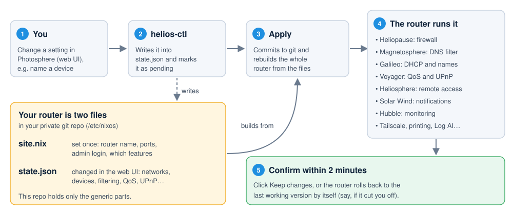

# How It Works

## The big picture

* `site.nix` holds the fixed parts of the router: host name, admin user, NIC MAC addresses, which features exist. See [Configuration](Configuration) for every `helios.*` option.
* `state.json` holds the parts that change often: networks, devices, QoS, UPnP, filtering profiles, drivers, hardware, remote access, printers, service switches. Photosphere edits it.
* `site.nix` reads `state.json` with `helios.state = builtins.fromJSON (builtins.readFile ./state.json);`. Every module reads `config.helios` and the parsed state; there is no other source of truth.
* The modules also write `/etc/helios/config.json` (host name, domain, networks, roles, catalogs, watched services, notification settings). `helios-ctl` and Photosphere read it, so the UI always agrees with what the modules built.
* Both files live in `helios.configDir` (default `/etc/nixos`), which is a git repository. `helios.stateFile` renames `state.json`.

## Networks, roles and access flags

A network is one VLAN and one /24. Without a `networks` list in `state.json` the five defaults from `pkgs/networks.json` are used; `templates/state.json` ships the same five, ready to edit.

Network fields: interface `name` (1 to 12 lowercase letters or digits, starting with a letter), `label`, `vlan`, `prefix` (first three octets, router is `.1`), optional `ipv6` subnet id, `role`, optional `color`, optional `access` overrides, optional `defaultProfile`.

Inside each /24: router `.1`, fixed addresses `.20` to `.99`, DHCP pool `.100` to `.250`. The modem's VLAN (`helios.interfaces.wanVlan`, default 10) is the WAN and cannot be a network.

A role is a set of default access flags. A network may override single flags; only the differences are stored, so later changes to a role still apply.

| Flag | trusted | family | iot | guest | strict | mgmt |
|---|---|---|---|---|---|---|
| `admin` | yes | no | no | no | no | yes |
| `internet` | yes | yes | yes | yes | yes | no |
| `reach` | all | none | none | none | none | none |
| `filtered` | no | yes | yes | yes | yes | no |
| `mdns` | yes | yes | yes | no | no | no |
| `printing` | yes | yes | no | no | yes | no |
| `upnp` | yes | yes | no | no | no | no |
| `cast` | yes | yes | no | no | no | no |
| `forceNtp` | no | no | yes | no | no | no |
| `tailnet` | yes | yes | yes | no | no | yes |
| `quarantine` | yes | yes | no | no | no | yes |

Default networks (no default for `guest`): trusted (VLAN 20, 10.20.0.0/24), family (30, 10.30.0.0/24), iot (40, 10.40.0.0/24), strict (50, 10.50.0.0/24), mgmt (99, 10.99.0.0/24).

### What each flag generates

| Flag | Effect in the built system |
|---|---|
| `admin` | The router accepts all traffic from this network (SSH, Cockpit on 9090, AdGuard on 3000). Other networks only get DNS, DHCP and NTP, plus the services their flags allow. Admin networks skip the probe trap and the source-address check. Photosphere and the router's own name use the first admin network's gateway. At least one network must have `admin`. |
| `internet` | Traffic may leave through `wan`. |
| `reach` | `all`, or a list of networks this one may open connections to. Replies always flow back. |
| `filtered` | DNS to any server is redirected to the router's AdGuard. Direct DNS-over-TLS (port 853), the DoH/public-resolver addresses and Cloudflare WARP ranges in `pkgs/blocklists.json` (and UDP 2408) are rejected. |
| `mdns` | Joins mDNS reflection (Avahi reflector, on only when more than one network has the flag) and accepts UDP 5353. |
| `printing` | Accepts TCP 631 and lets CUPS answer that subnet. |
| `upnp` | Accepts SSDP (UDP 1900), NAT-PMP (UDP 5351) and miniupnpd control (TCP 5000); miniupnpd serves only these networks. |
| `cast` | May reach devices marked "media" on other networks. |
| `forceNtp` | Outgoing UDP 123 is redirected to the router, whatever server the device hard-codes. |
| `tailnet` | The network's /24 is advertised as a Tailscale subnet route (when `helios.tailscale.advertiseRoutes` is on). |
| `quarantine` | Devices you have not named yet get filtered internet only (see below). |

### Firewall layout (Heliopause)

Two nftables tables, `heliopause` and `heliopause-nat`, both policy-drop on input and forward.

Input (traffic to the router):

* loopback accepted; the rescue address answers only on the rescue port;
* established and related accepted, invalid dropped; ICMP accepted, with WAN echo requests above 10 per second dropped;
* on non-admin networks, TCP to the trap ports (22, 23, 80, 443, 2222, 3000, 8080, 8090, 9090, and the notification port when Solar Wind is on) is dropped, and the source is added to a set and logged once per hour with the prefix `heliopause-trap:`. DNS, DHCP and NTP keep working;
* admin networks, the rescue port and `tailscale0` are accepted;
* WAN accepts DHCPv6 replies and, when Tailscale is enabled, UDP 41641.

Forward (traffic through the router):

1. devices in the `cutoff` set (paused devices) are rejected or dropped, so pausing also kills open connections;
2. established and related accepted;
3. anti-spoofing: a non-admin network may only send from its own subnet;
4. unnamed devices on `quarantine` networks are sent to a restricted chain;
5. bypass blocking for `filtered` networks;
6. Tailscale (`tailscale0`) reaches every network;
7. `reach` rules;
8. connections that UPnP or NAT-PMP port forwards created on `wan`;
9. Heliosphere clients may reach only the home networks their way in allows;
10. media pinholes and casting;
11. `internet`: accept to `wan`; anything not allowed above is dropped.

NAT: IPv4 masquerade on `wan`, IPv6 masquerade for exit-node traffic from `tailscale0`, DNS and NTP redirection, and the WireGuard and OpenVPN port forwards to Heliosphere.

### Unnamed devices (quarantine)

On networks with `quarantine`, devices whose MAC is not in `state.json` get only filtered internet, DNS forced through AdGuard, no other networks and no router admin pages (the trap still applies). It is matched by MAC, so it covers IPv4 and IPv6. It needs `"restrictUnnamed": true` and takes effect only once at least one device on an admin network is named, so a fresh install cannot lock you out. Tailscale and the rescue port are never restricted. New sites from the template start with it on.

### Media servers

Per device in `state.json`: `media` marks a TV or similar, `mediaServer` (`tcp`, `udp`, `networks`) marks a server. Media devices on non-admin networks may reach the server's ports; `networks` lists whole networks that may too. Discovery broadcasts do not cross VLANs, so clients need the server's address (`<name>.<domain>`).

## From a click to a running router

1. You edit something in [Photosphere](Page-Header-and-Navigation). It runs `helios-ctl` (as root, through Cockpit's superuser channel), which edits `state.json` in `configDir`. The change shows in the pending banner.
2. Discard restores `state.json` from git.
3. Apply runs `helios-ctl apply-start`, which refuses with "nothing to apply" if `state.json` is unchanged. It starts a systemd unit (`helios-apply`) so closing the browser cannot kill the rebuild, and that runs `nixos-rebuild switch` in `configDir`.
4. If the rebuild fails, the file is unstaged, nothing on the router changed and your edits stay pending.
5. If it succeeds, `helios-ctl` syncs AdGuard client profiles, cleans up removed printers, then starts a 120 second timer (`helios-autorollback`).
6. **Keep changes** commits `state.json` to git (message summarises the changes) and stops the timer. **Revert now**, or no confirmation within 120 seconds, runs `nixos-rebuild switch --rollback`, restores `state.json` from git and re-syncs AdGuard.
7. [History](Page-History) lists the git commits; Restore loads an older `state.json` as a new pending change. Backups and pauses are commits too.

Not everything goes through a rebuild:

| Action | How |
|---|---|
| Pause or resume a device | Adds or removes its IP in the live `cutoff` nft set, and commits just that toggle. No rebuild, no confirmation. |
| Secrets (WireGuard keys, OpenVPN PKI, proxy users, egress files) | Written immediately under `/var/lib/heliosphere/`; never in `state.json` or git. |
| Nightly backup | Copies AdGuard's settings into `backups/adguard` in `configDir`, commits, and pushes if a git remote exists. |

`helios-ctl` also works on the command line: `sudo helios-ctl status`, `sudo helios-ctl devices`. Every command prints JSON.

## Modules

`modules/default.nix` imports these in order. All specifics come from `options.nix`.

| Module | Space name | What it does |
|---|---|---|
| `options.nix` | options | Declares `helios.*`, resolves networks and service switches from `state.json`, runs the build-time checks, writes `/etc/helios/config.json`. |
| `network.nix` | network | Pins NIC names by MAC (`trunk0`, optional `rescue0`), creates the `wan` VLAN and one VLAN interface per network, Avahi, chrony for every network, sysctl hardening. With mapped router ports it builds a VLAN-aware bridge `lan0`. |
| `galileo.nix` | Galileo | Kea DHCP on every network (2 hour leases, router as gateway, DNS and NTP, fixed reservations for named devices) and local names `<device>.<domain>` for every named device. Named after Galileo, who named Jupiter's moons. |
| `heliopause.nix` | Heliopause | The firewall described above. Also holds Magnetosphere's DNS hijack and bypass blocks, because nftables needs them in the same chains. |
| `magnetosphere.nix` | Magnetosphere | Turns off systemd-resolved, points the router at 127.0.0.1, enables AdGuard Home with mutable settings. Per-device profiles are synced from `state.json` by `helios-ctl` on every apply, using `/var/lib/helios/adguard.json`. |
| `access.nix` | access | Admin user in `wheel` with your SSH keys; SSH with keys only, no root login, no X11, 3 auth tries; password login only on the rescue address; port 22 not opened on the WAN. |
| `tailscale.nix` | tailscale | The router joins the tailnet with the configured tag, `--accept-dns=false`, `--netfilter-mode=off` (Heliopause handles `tailscale0`), optionally advertises an exit node and the `tailnet` networks as subnet routes, optionally with `--login-server` for Headscale. |
| `heliosphere.nix` | Heliosphere | A NixOS container (`ve-heliosphere`, 10.60.0.2, host side 10.60.0.1) with the ways in and out, below. |
| `solar-wind.nix` | Solar Wind | ntfy-sh with deny-all access, no sign-ups, 72 hour cache. A setup unit generates a write-only token for the router and a read-only phone login on first boot. Optional Tailscale Funnel unit. |
| `photosphere.nix` | Photosphere | Installs `helios-ctl` and the Cockpit plugin, enables Cockpit on port 9090 (not opened by NixOS; Heliopause admits admin networks and Tailscale), and the timers for the outage monitor (every 30 seconds) and the nightly backup (03:17). |
| `voyager.nix` | Voyager | QoS service `helios-sqm` (CAKE or fq_codel plus HTB on `wan`, download shaped through an `ifb4wan` mirror) and miniupnpd for UPnP and NAT-PMP with a deny list. |
| `hubble.nix` | Hubble | Loads the Intel `iTCO_wdt` watchdog module, runs vnStat for traffic history, sets the hardware watchdog (reboot after 30 seconds of hang, force a stuck shutdown after 10 minutes). |
| `printing.nix` | printing | CUPS shared to networks with `printing`, ipp-usb, printers from `state.json`, Avahi publishing. |
| `discovery.nix` | Discovery | Optional AI log triage (below). |
| `drivers.nix` | drivers | Hardware detection timer, LLDP listening, UPS through Network UPS Tools, weekly vulnix scan. |
| `recovery.nix` | recovery | Restarts failed services, alerts, reboot checks and the optional reboot window. |

### Heliosphere in detail

Everything inside the container inherits its isolation, because the host treats `ve-heliosphere` as a filtered, internet-only network.

* Ways in (any mix, set in `state.json` `heliosphere.ingress`): Tailscale (exit node, default on), WireGuard (10.61.0.0/24, UDP port forwarded from the WAN), OpenVPN (10.62.0.0/24), and a SOCKS5/HTTP proxy (3proxy) offered only to chosen home networks, never on the WAN.
* Each way in may be allowed to reach chosen home networks (`lan`); by default none. The container enforces this per interface and the host allows the union.
* Way out (one at a time, `heliosphere.egress`): `direct`, `wireguard` (wg-quick with a provider config), `openvpn` (a provider `.ovpn`), or `proxy` (tun2socks through an upstream proxy). The kill switch (default on) drops container traffic if the tunnel is down.
* DNS: clients always get the router's AdGuard (10.60.0.1); the container also blocks DoT and the DoH/WARP addresses itself, because the host cannot see inside a tunnel. All clients look like 10.60.0.2 to AdGuard and share one profile.
* Secrets under `/var/lib/heliosphere/`; the OpenVPN CA stays on the host and is not mounted into the container. Client private keys are shown once when created and not stored.
* Network ranges 10.60.0.0/24, 10.61.0.0/24 and 10.62.0.0/24 are reserved; a network cannot use them.

Design notes: `docs/heliosphere.md` in the repository.

### Discovery (AI log triage) in detail

* A timer (every 10 minutes by default) runs `logwatch`: it reads journal warnings since the last run, drops known noise, alerts immediately on hard-coded critical patterns (disk and kernel errors, link down, failed units, any successful SSH login, the `heliopause-trap:` hits) without any model, collapses repeats, and sends only patterns not seen in the last seven days to a local model.
* Urgent results go to the `flare` topic, notable ones to `aurora`.
* It must not hurt routing: a low-priority slice (CPU weight 10, memory cap), the model loaded only for each run unless "keep loaded" is set, and a guard that checks CPU and memory pressure every minute and pauses triage for hours when the router is busy.
* The model is a llama.cpp server on 127.0.0.1:8090 (Vulkan or CPU), or an existing remote llama.cpp server. Presets are Qwen3 models from Hugging Face, downloaded on request and checked against a SHA-256 in `pkgs/logwatch-models.json`.

### Service recovery

* Watched services restart on failure, 5 seconds apart, at most 5 times in 10 minutes. One-shots such as the firewall load only alert.
* When a unit ends up failed, an urgent notification with the last log lines is sent.
* `helios-recover` runs every 10 minutes: it retries failed services (30 minute cooldown, at most 6 attempts a day), sends "back" when one recovers, and escalates once if it cannot.
* A new kernel only runs after a reboot. `helios-reboot-check` runs daily and notifies once. The optional reboot window (`maintenance.rebootWindow`) reboots only inside the window and only if needed.

### Drivers

Built-in drivers are listed in `pkgs/drivers.json`: `manual` (checklists for switches and access points), `local-ports` (the router's own extra ports), `lldp` (listen-only neighbour discovery), and `nut` (UPS). Detection (`helios-detect`, every 6 hours) is read-only and runs sandboxed. See [Page-Hardware](Page-Hardware). `docs/drivers.md` describes the design.

## Name glossary

| Name | Meaning in HeliOS |
|---|---|
| Heliopause | firewall |
| Magnetosphere | DNS filtering (AdGuard Home) |
| Heliosphere | remote access container |
| Photosphere | web UI (Cockpit plugin) |
| Solar Wind | notifications (ntfy) |
| flare | the urgent notification topic |
| aurora | the informational notification topic |
| Voyager | QoS and UPnP at the WAN edge |
| Hubble | watchdog and traffic stats |
| Discovery | AI log triage (`logwatch` in code) |
| `helios-ctl` | the backend; JSON in, JSON out |
| `trunk0`, `rescue0`, `wan`, `lan0` | reserved interface names: trunk NIC, rescue NIC, WAN VLAN, bridge |
| trap | the logged drop of probes at the router's admin ports from non-admin networks |

Device naming in the UI follows the theme: planets and moons for most networks, Kuiper belt objects for roles marked that way (iot and mgmt).
